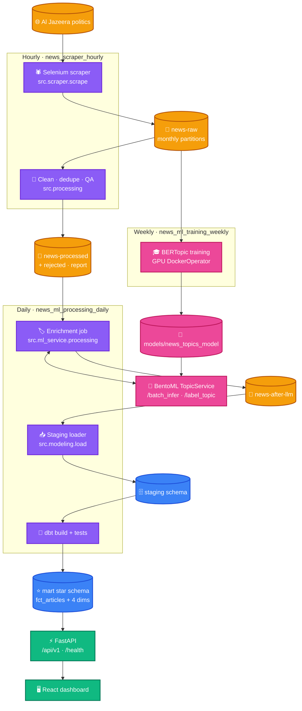

# Eyes on the Middle East

What is Arabic news actually talking about, and for how long?

This project follows Al Jazeera's political coverage, reads thousands of
articles, and sorts them into the themes running through them — the war in
Gaza, the conflict in Sudan, migration into Europe — each named in Arabic. The
result is a dashboard showing which stories dominate a given week, how long
they hold attention, and when the conversation moves somewhere else.

It runs on its own: new articles arrive every hour, get grouped and labelled
overnight, and the topic model is retrained weekly as coverage shifts.


## 🎯 Features

- **Incremental scraping** — each run resumes from the newest stored publication
  date minus a rescan buffer, and skips links already held in full. A run after
  5,157 stored articles fetched 330 new ones, not 5,487.
- **Monthly partitioning end to end** — Bronze, Silver and enriched layers share
  one `year=YYYY/month=MM` scheme keyed on publication date, so a rebuild touches
  only the months that changed.
- **Arabic-aware processing** — aggressive normalization for matching and
  deduplication, light normalization for embedding, so stored text stays readable.
- **Topic modelling as a service** — BERTopic inference and LLM labelling behind
  a BentoML HTTP API, shared by the daily enrichment job and anything else.
- **Warehouse with tests, not constraints** — dbt builds a star schema and
  verifies keys, relationships and row counts as data tests.
- **Read-only serving** — a FastAPI layer over the marts plus a React dashboard;
  neither can write to the warehouse.

## 🏗️ Architecture

Four paths, three schedules. The hourly path lands raw and cleaned articles; the
daily path enriches them and rebuilds the warehouse; the weekly path retrains the
topic model; serving reads the marts and nothing else.



## 🚀 Quick Start

### Prerequisites

- **Python 3.11+** and **[uv](https://docs.astral.sh/uv/)**
- **Docker Desktop** with Compose
- **NVIDIA GPU** — only for weekly training; scraping, enrichment and serving run
  on CPU

### Configuration and secrets

Non-secret settings live in `config/config.yml`. Secrets live in `.env`, which is
gitignored, so a fresh checkout needs it created before anything runs:

```powershell
cp .env.example .env
```

`.env.example` lists every variable with a note on what it is for and which ones
have no sensible default.

`src/config.py` loads `.env` with `override=False`, so a real environment
variable — what Compose and Airflow inject — still wins over the file. Compose
reads the same file independently for `${...}` interpolation.

`HOST_PROJECT_DIR` must be a **host** path: the weekly training task asks the
Docker daemon for a sibling container, so its bind mounts are resolved on the
host, not inside Airflow.

### Install and run

```powershell
uv sync --frozen --group api --group warehouse --group dev --group ml
```

> `uv sync` is exact — it removes any group you do not name. Pass all four, or a
> later command will fail on a missing import.

```powershell
docker compose build
```

```powershell
docker compose up -d
```

```powershell
uv run python -m src.datalake.init_storage
```

Then unpause the DAGs. Each starts a run immediately for its most recent
interval:

```powershell
docker compose exec airflow-scheduler airflow dags unpause news_scraper_hourly
```

```powershell
docker compose exec airflow-scheduler airflow dags unpause news_ml_processing_daily
```

```powershell
docker compose exec airflow-scheduler airflow dags unpause news_ml_training_weekly
```

### Where things are

| Service | Address | Notes |
|---|---|---|
| Dashboard | http://localhost:8080 | React SPA behind nginx |
| API | http://localhost:8000 | `/docs` for the interactive browser |
| Airflow | http://localhost:8081 | `admin` / generated password, below |
| BentoML | http://localhost:3000 | `ml-serving`, also on the compose network |
| SeaweedFS filer | http://localhost:8888/buckets/ | browsable object store |
| SeaweedFS master | http://localhost:9333 | volumes and cluster health |
| PostgreSQL | `localhost:5433` | database `news_dwh`, user `news_admin` |

`AIRFLOW__CORE__SIMPLE_AUTH_MANAGER_USERS` is `username:ROLE`, not a credential
pair. The password is generated on first start:

```powershell
docker compose exec airflow-apiserver cat /opt/airflow/simple_auth_manager_passwords.json.generated
```

## 🐳 Deployment

Eleven services, four images. The split exists because CUDA is needed in exactly
one place: a single image carrying Airflow, Chromium, dbt and torch came to
14.6 GB, most of it unused by every task except training.

| Image | Size | Used by |
|---|---:|---|
| `ajnet-ml` | 9.94 GB | `ml-serving`, weekly training — cu124 torch, BERTopic |
| Airflow | 6.01 GB | scheduler, api-server, dag-processor, triggerer |
| `api` | 774 MB | FastAPI over the marts |
| `frontend` | 94.9 MB | nginx serving the built SPA |

The API and frontend images carry their own code; the Airflow services bind-mount
`src/` and `dags/` so edits apply without a rebuild.

**Vite inlines `VITE_API_URL` at build time**, so the frontend image is tied to one
API host. It defaults to `http://localhost:8000` — the browser resolves it, not
the compose network, so a service name would not work:

```powershell
docker compose build --build-arg VITE_API_URL=https://api.example.com frontend
```

`ml-serving` loads the topic model at startup, so restart it after a retrain:

```powershell
docker compose restart ml-serving
```

It embeds on CPU by default. `resolve_device()` falls back to CPU when CUDA is
unavailable, so `ML_SERVING_DEVICE=cuda` without a GPU reservation degrades
rather than crashes.

## 📋 Configuration

All settings live in `config/config.yml` and are read through `src/config.py` —
no literal paths or hyperparameters anywhere else.

```yaml
scraper:
  base_url: https://www.ajnet.me/politics
  default_start_date: 2026-1-01
  rescan_buffer_hours: 3      
  max_scrolls: 500

ml:
  model_dir: models/news_topics_model
  device: cuda              

llm:
  model: openai/google/gemini-2.5-flash
  max_headlines: 8         

warehouse:
  host: 127.0.0.1              
  port: 5433
  database: news_dwh

api:
  mart_schema: mart
  default_page_size: 8
  max_page_size: 100
  cors_origins:                 
    - http://localhost:8080
    - http://127.0.0.1:8080
```

Any value can be overridden by environment variable:

```powershell
$env:EMBED_DEVICE="cpu"
$env:DWH_HOST="news-postgres"
```

> **`127.0.0.1`, not `localhost`.** Windows resolves `localhost` to IPv6 `::1`
> first and the container publishes IPv4 only, so every warehouse connection paid
> a 10-second connect timeout — measured at 130 s raw versus 0.01 s. Airflow
> overrides this with `DWH_HOST=news-postgres` regardless.

### Dependency groups

Split by role so no environment installs what it does not run.

| Group | Purpose | Notable contents |
|---|---|---|
| *(default)* | Scraping, serving contracts | `selenium`, `beautifulsoup4`, `boto3`, `bentoml`, `litellm` |
| `ml` | Training and inference | `bertopic`, `sentence-transformers`, `torch` (cu124) |
| `api` | Read layer | `fastapi`, `uvicorn[standard]`, `psycopg[binary]` |
| `warehouse` | Loading and modelling | `dbt-postgres`, `psycopg[binary]` |
| `dev` | Tests | `pytest` |

## 🗂️ Storage layout

Publication date determines the partition. Missing or unparseable dates land in
`undated/`.

| Layer | Object path | Local mirror |
|---|---|---|
| Bronze | `news-raw/aljazeera/year=YYYY/month=MM/articles.json` | `data/raw/aljazeera/` |
| Silver | `news-processed/aljazeera/silver/year=YYYY/month=MM/` | `data/processed/` |
| Enriched | `news-after-llm/aljazeera/year=YYYY/month=MM/` | `data/after_llm/` |

Silver carries `processed_articles.json`, `rejected.json` and `report.json` per
partition — rejects keep their original payload and the reason they failed.

## ⏱️ Airflow workflows

All schedules are **Africa/Cairo**, catchup disabled, one active run each, two
retries.

| DAG | Schedule | Tasks |
|---|---|---|
| `news_scraper_hourly` | hourly | `scrape_and_upload → process_and_upload` |
| `news_ml_processing_daily` | 00:00 daily | `enrich_and_upload → load_staging → build_and_test_mart` |
| `news_ml_training_weekly` | 00:00 Sunday | `train_topic_model` |

Training runs as a `DockerOperator` sibling container on the `ajnet-ml` image with
a GPU device request; the other tasks are `BashOperator` calls into the
per-purpose virtualenvs baked into the Airflow image. dbt writes to the writable
`logs/dbt` and `data/dbt/target` mounts because `src/` is mounted read-only.

Weekly training and daily enrichment are independent and can overlap on a Sunday.
There is no automatic model handoff — `ml-serving` keeps serving the artifacts it
loaded at startup until restarted.

## 🧱 Warehouse

The loader upserts `staging.enriched_articles` by article id, preserving
timestamps on unchanged payloads. dbt rebuilds the marts in full:

| Relation | Grain |
|---|---|
| `staging.stg_enriched_articles` | Prepared dates, keys, sources, measures |
| `mart.fct_articles` | One row per article — current classification, counts |
| `mart.dim_article` | Id, URL, headline, summary, paragraphs |
| `mart.dim_topic` | Model-scoped topic, label, summary, outlier flag |
| `mart.dim_source` | Source name and domain |
| `mart.dim_date` | Calendar attributes |

Topics are **model-scoped**: `topic_key` derives from `(model_version, topic_id)`,
so a retrain produces a fresh set of rows and the same `topic_id` can appear under
two versions. Relationships are enforced by dbt data tests, not foreign keys.

## 🖥️ API and dashboard

Ten read-only endpoints under `/api/v1` — articles (paginated, filterable by
topic, free text and date range), topics, distribution, weekly trends, sources and
summary stats — plus `/health`, which reports `degraded` while `fct_articles` is
empty so an unbuilt warehouse reads as empty rather than broken.

The dashboard is a React 18 + Vite SPA using TanStack Query and Recharts. Two v1
panels have no v2 equivalent and were replaced rather than faked: author rankings
(the pipeline no longer keeps `Publisher`) and keyword clouds (c-TF-IDF terms stay
in the BentoML service and never reach the warehouse).

For development against a live API without containers:

```powershell
uv run uvicorn src.api.main:app --reload --port 8000
```

```powershell
cd src/frontend; npm install; npm run dev
```

## 🏗️ Project Structure

```
Eyes-on-the-MiddleEast-v2/
├── config/
│   └── config.yml                 # Every setting; secrets stay in .env
├── src/
│   ├── config.py                  # YAML + .env loader, single source of truth
│   ├── schemas.py                 # Shared article/topic contracts
│   ├── scraper/                   # Crawling, extraction, incremental storage
│   ├── datalake/
│   │   ├── partitions.py          # Monthly partition keys, merge, atomic write
│   │   ├── init_storage.py        # Bucket creation
│   │   └── migrate_partitions.py  # Legacy snapshot → partitions
│   ├── processing/                # Cleaning, Arabic normalization, quality gates
│   ├── ml_service/
│   │   ├── training.py            # Weekly BERTopic training
│   │   ├── service.py             # BentoML TopicService
│   │   ├── llm.py                 # litellm structured labelling
│   │   └── processing.py          # Silver → enriched job
│   ├── modeling/
│   │   ├── load.py                # Enriched JSON → staging upsert
│   │   ├── dbt.py                 # Config-aware dbt launcher
│   │   └── models/                # staging view, fact and dimensions
│   ├── api/
│   │   ├── main.py                # App, CORS, /health
│   │   ├── routers/v1/            # articles · topics · sources · stats
│   │   ├── services/              # SQL against the marts
│   │   └── schemas/               # Pydantic response contracts
│   ├── frontend/                  # React + Vite dashboard
│   ├── orchestration/dags/        # Three Airflow workflows
│   └── infrastructure/docker/     # Airflow · ml · api · frontend images
├── tests/                         # pytest — scraper, modeling, API
├── data/                          # Partitioned layers, dbt target
├── models/                        # Trained topic model artifacts
├── docker-compose.yml
└── pyproject.toml
```

## 🛠️ Development

### Running stages by hand

```powershell
uv run python -m src.scraper.scrape
```

```powershell
uv run python -m src.processing.processing
```

```powershell
uv run python -m src.ml_service.processing
```

```powershell
uv run python -m src.modeling.load --model-version legacy-unversioned
```

```powershell
uv run python -m src.modeling.dbt build
```

Processing reads Bronze from SeaweedFS and publishes Silver by default. To
preview local input without uploading:

```powershell
uv run python -m src.processing.processing --input data/raw/aljazeera --local-only
```

## 📝 License

Released under the MIT License. See [LICENSE](LICENSE).

The code is MIT; the scraped articles are not. Al Jazeera retains copyright over
its content, so the corpus under `data/` is for analysis and is not
redistributed with this repository.